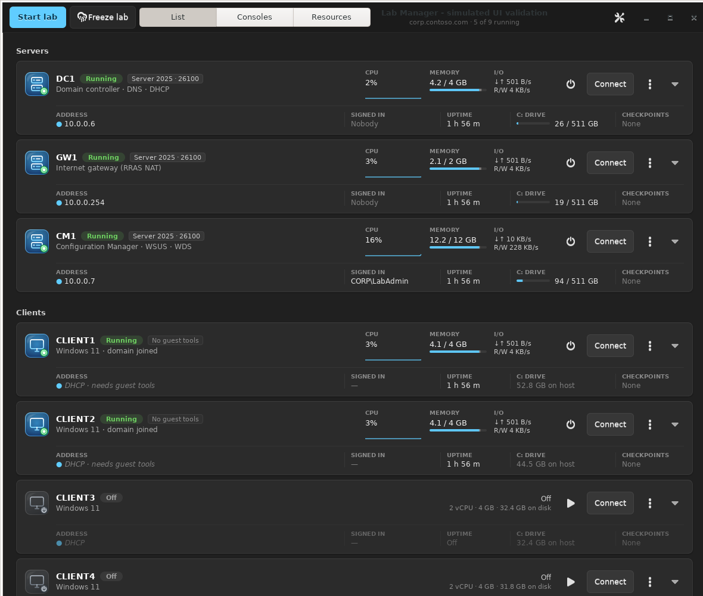
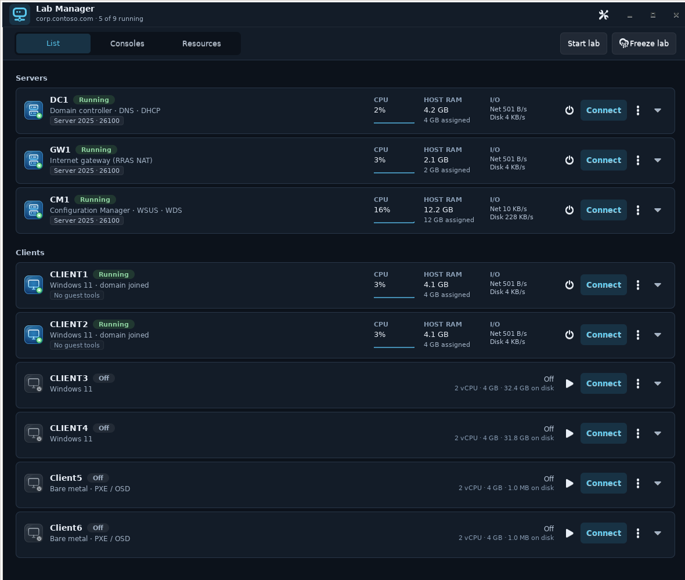
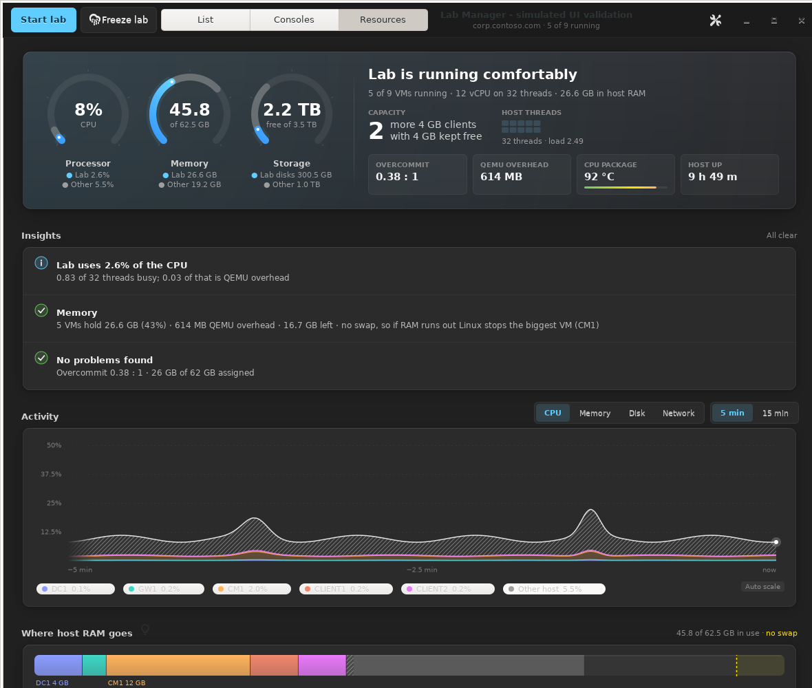
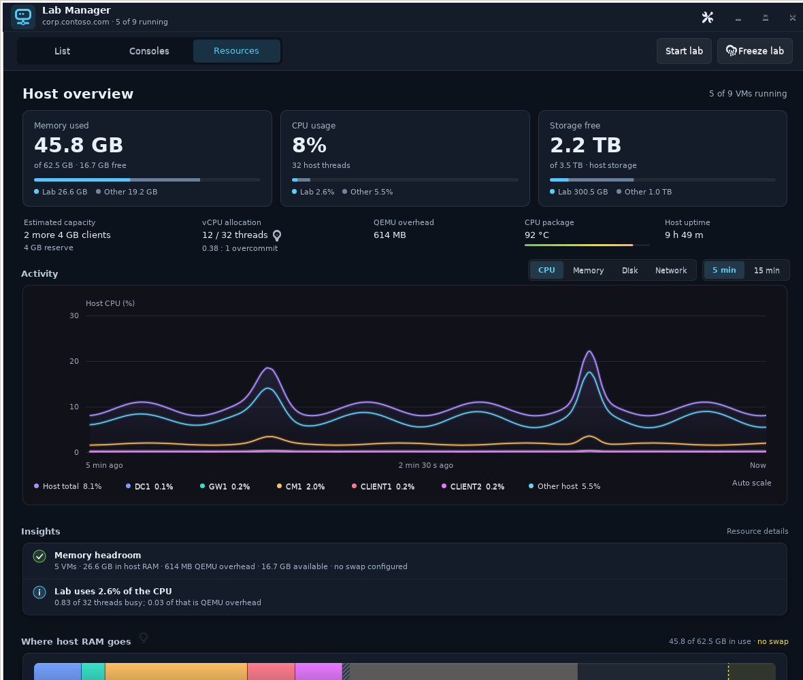

# Lab Manager UI validation

This change applies the approved compact slate layout and neon Activity chart to
the native GTK3 app in `Linux/manager/labmanager.py`.

The screenshots below use deterministic simulated data on a private Xvfb display.
They are renders of the actual GTK widgets, not mockups or captures from the live lab.
The baseline is commit `c0b9599a0af6765c8b41af73bdcc9575b991224f`.

## Visible changes

- A compact title bar and separate navigation/action toolbar.
- Aligned VM rows with host RAM and assigned guest RAM labeled separately.
- Remembered facts/details expanders, with warning chips remaining visible.
- Smaller Memory, CPU and Storage cards, followed by Activity and condensed Insights.
- Smooth neon component traces, a violet total and a restrained gradient fill.
- An explicit cyan Linux & apps memory trace and round memory-axis ticks.
- Raw sample hover values, readable relative times and honest startup history.
- Five- and fifteen-minute views that preserve peaks and break across missing intervals.

CPU and memory totals are independently measured host values. Disk and network
totals describe tracked lab VMs and retain both directions. Curve geometry is
shape preserving; smoothing does not invent measured values or change tooltips.

## Before and after

### List

| Before | After |
| --- | --- |
|  |  |

### Resources and Activity

| Before | After |
| --- | --- |
|  |  |

Additional captures: [memory](after-memory.png), [hover](after-hover.png),
[resource table](after-table.png) and [Consoles](after-consoles.png).
The console thumbnails are explicitly simulated placeholders.

## Checks

Run from the repository root:

```bash
python3 -B -m unittest discover -s Linux/manager/tests -p 'test_*.py' -v
/usr/bin/python3 -B Linux/manager/tests/render_fixture.py --output /tmp/lab-manager-ui
/usr/bin/python3 -B Linux/manager/tests/render_fixture.py --output /tmp/lab-manager-ui-stress --width 1024 --height 900 --stress
git diff --check
```

The display-free tests cover curve bounds, extrema, missing values, timestamp
alignment, time-window gaps, raw five/fifteen-minute histories, startup and the
semantics of CPU/memory and directional I/O totals. All **21 tests passed**.

The screenshot fixture covers List, expanded details, Consoles, all four Activity
modes, hover, fifteen-minute history, empty/one/three-sample history and the lower
resource table. It exercises the actual mode/range controls. Both 1180 × 1000 and
1024 × 900 windows were checked without GTK callback errors.

The fixture blocks live libvirt connections, guest-agent commands and VM actions.
Guest and console workers are disabled, settings stay in memory and Xvfb is
started with TCP listening disabled. No VM power control or sign-in is exercised.

## Timing scope

The [1180-pixel timing report](measurements-1180.json) and
[1024-pixel stress report](measurements-stress-1024.json) separate synchronous tick work,
resource rendering and chart drawing. The stress run forces uncached redraws
with nine running simulated VMs and 450 raw samples per series. Cached hover
redraws reuse the plot surface when its time position is unchanged. GTK frame-clock
callbacks now scroll the chart between measurements, with one sampling interval
(about two seconds) of display latency. Hidden views do not redraw, disabled
animations are respected, and telemetry polling remains unchanged. The time axis
uses a fixed window to avoid startup zoom jumps. Scrolling stops when data stalls.
The measurements below predate continuous scrolling and describe individual draws.

Final 1024 × 900 stress run, in milliseconds:

| Uncached chart | Median | 95th percentile | Maximum |
| --- | ---: | ---: | ---: |
| CPU | 13.561 | 19.472 | 24.919 |
| Memory | 5.207 | 6.956 | 7.986 |
| Disk | 11.431 | 15.785 | 24.118 |
| Network | 14.053 | 17.259 | 21.930 |

The 1180-pixel fixture's synchronous tick had a 0.390 ms median and a 1.948 ms
95th percentile. These are separate measurements, not a complete live refresh.
The stress run's outliers mean this evidence does not establish a strict 20 ms cap.

These measurements exclude live libvirt collection and real console image
decoding. The ordinary refresh target is approximately 20 ms on the lab machine.
Live-lab timing remains a review item, including the previously reported roughly
48 ms Consoles decode path, which is deferred from this UI change.

VM power/control methods, console connection behavior and settings persistence
were compared with the baseline and are unchanged.

## Local installation verification

On 2026-10-29, the UI patch was installed on the Linux lab machine using
`Linux/manager/install.sh` and launched through the installed desktop entry.
The installed source matched the independently validated copy byte for byte,
and all 21 unit tests passed from the installed location. The compact List view
and the Resources CPU and Memory charts were visually verified with live data.
The application log reported no errors during verification.

All nine VM states, running instance IDs and saved-state flags matched the
pre-install snapshot: five running and four shut off. No VM power operations,
guest sign-ins or clock changes were performed. The application was left open
on Resources with the live CPU Activity chart selected. This verifies the
installed UI; it does not establish live refresh timing. The branch remains
unmerged pending review.
