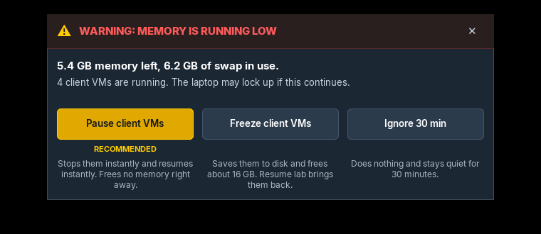

# VM memory guard

A small background service for the Linux lab host. When memory runs low while the client VMs are
running, it shows a warning window and offers to pause or freeze them. If nobody answers and
memory is nearly gone, it pauses the client VMs itself so the desktop does not lock up.



## Why

The full lab (DC1, GW1, CM1 and four clients) is allowed up to 34 GB. On a 62 GB laptop with no
swap, a large build on top of that used all the memory and the machine locked up hard enough to
need the power button. The kernel never killed anything to recover.

## What it does

| Level | When | Action |
| :--- | :--- | :--- |
| Warning | Under 6 GB available, or over 4 GB of swap in use | Window with **Pause client VMs**, **Freeze client VMs**, **Ignore 30 min** |
| Last resort | Under 2 GB available and half the swap used (or no swap) | Pauses the client VMs, then offers **Resume now**, **Freeze instead**, **Keep paused** |

- **Pause** stops the VMs instantly and resumes them instantly. They keep their memory, but a
  paused VM no longer touches it, so the kernel can move it to swap and leave it there.
- **Freeze** is Lab Manager's *Freeze lab* for the clients only: each VM is saved to disk
  (`virsh managedsave`) and its memory is freed. *Resume lab* in Lab Manager brings them back.
- The window marks one of the two as recommended: Pause while swap has room, Freeze once more than
  a quarter of swap is used or under 4 GB is available.
- Only VMs with `client` in the name are touched. DC1, GW1 and CM1 keep running.
- An alert sound plays on the default output and on the laptop speakers, so it is heard when the
  default output is a headset nobody is wearing.

The lab VMs have no memory balloon device, so they cannot be shrunk while running. Pause and
freeze are the two levers that exist.

## Add swap first

The guard works best with swap; without it, Pause frees nothing and the last-resort level is
reached sooner. A 32 GB swap file on an ext4 root:

```bash
sudo fallocate -l 32G /swapfile && sudo chmod 600 /swapfile && sudo mkswap /swapfile && sudo swapon /swapfile
echo '/swapfile none swap sw 0 0' | sudo tee -a /etc/fstab
```

## Install

```bash
./install.sh            # copies to ~/.local/share/vm-memory-guard, enables the user service
./install.sh --remove   # stops and removes it
```

No sudo. The user must be in the `libvirt` group, as for Lab Manager.

## Files

| File | What it is |
| :--- | :--- |
| `vm-memory-guard.py` | The service: thresholds, when to warn, pause / resume / freeze. Thresholds are the constants at the top. |
| `warning-window.py` | The warning window (GTK 3). Takes one JSON argument, prints the chosen action's key. |
| `sample-spec.json` | Sample input for working on the window without the service. |
| `blank.svg` | Transparent icon for the plain progress notifications. |

## Try it

```bash
python3 warning-window.py "$(cat sample-spec.json)"                   # window only; prints the key, does nothing else
python3 ~/.local/share/vm-memory-guard/vm-memory-guard.py --status   # current numbers and client VM states
python3 ~/.local/share/vm-memory-guard/vm-memory-guard.py --test     # the real warning: the buttons act on the VMs
journalctl --user -u vm-memory-guard                                 # what it has done
```

## Notes

- The window runs under XWayland (`GDK_BACKEND=x11`) because a native Wayland window cannot keep
  itself above other windows or choose where it opens.
- Its CSS is loaded at user priority + 1 so a personal `~/.config/gtk-3.0/gtk.css` cannot
  override the warning colours.
- **Resume now** resumes every paused client VM, including one paused by hand.
- Tested: the warning window, Pause, and Resume now. Not yet exercised on a real lab: Freeze from
  the window, and the automatic pause under real memory pressure.
